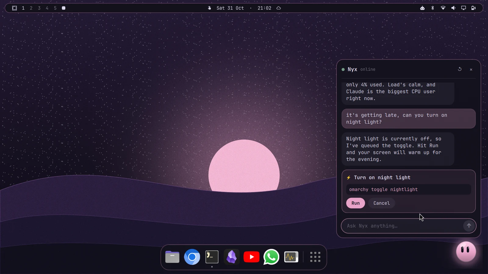

<div align="center">

<picture>
  <source media="(prefers-color-scheme: dark)" srcset="docs/images/banner-dark.svg">
  
</picture>

<br><br>

[](https://omarchy.org)
[](#settings)
[](https://quickshell.org)
[](LICENSE)

[Install](#install) &nbsp;·&nbsp; [Remove](#remove) &nbsp;·&nbsp; [What it does](#what-it-does) &nbsp;·&nbsp; [Use](#use) &nbsp;·&nbsp; [Settings](#settings) &nbsp;·&nbsp; [Benchmarks](docs/benchmarks.md) &nbsp;·&nbsp; [How it works](#how-it-works)

<br>



</div>

<br>

Nyx is a small glowing orb that sits in the corner of your screen. It's
made of something like jelly: it wobbles when you poke it, sheds little
sparkles when it's happy, and glows to the beat of whatever you're playing.
It watches your mouse, worries when the battery runs low and falls asleep
when you walk away. Click it and it talks back.

**No API keys and no new accounts.** Nyx runs on the Claude Code or Codex
you already use, on your existing plan. If one of them works in your
terminal, Nyx works too.

It knows your machine. Ask why the fan is loud, what's eating memory, or to
switch your theme, and it looks before it answers. It never changes anything
on its own: every change comes back as a **Run / Cancel** card.

## What it does

<div align="center">
  
</div>

- **Chat:** click the orb or press `Super+N`. Answers come from Claude Code
  or Codex, whichever you have, so it's actually smart.
- **Knows your machine:** reads battery, memory, processes, Hyprland windows,
  your config and the `omarchy` commands on its own, so answers are about
  *your* computer, not computers in general.
- **Asks first:** anything that changes something shows the exact command
  with **Run / Cancel**. Nothing runs until you click.
- **Feels alive:** a liquid body that wobbles like jelly, sparkles that
  change with its mood, and a soft violet glow that lights up the desktop
  around it and pumps with the beat of your music.
- **Reacts:** sways to music, worries under 20 % battery, hops at
  notifications, yawns after 11 pm, sleeps with little z's when you're away,
  and wakes up when the music starts.
- **Speaks up:** little speech bubbles through your day, never the same line
  twice in a row: good morning, a stretch nudge after 90 minutes, teasing
  about late-night coding, a new song, headphones on, Wi-Fi dropping, running
  hot, low battery (offers power saver), late night (offers night light).
  Click a bubble to keep talking, or its button to let Nyx look into it. A
  button that would change something opens a Run / Cancel card first.
- **Small talk:** in `chatty` mode, Nyx now and then comes up with a fresh
  one-liner about the moment, written by the AI, so it never sounds canned.
- **Light:** about 4 % of one CPU core while idle; it only animates fast
  while it's actually moving.
- **Your theme:** uses your Omarchy colors, so switching themes restyles Nyx
  too.

## Install

Needs **Omarchy 4** and one brain:

- **[Claude Code](https://claude.com/claude-code)** (default), installed and logged in,
- **[Codex](https://github.com/openai/codex)**, installed and logged in, with `"brain": "codex"`, or
- **any OpenAI-compatible API** (OpenRouter, OpenAI, Groq, Ollama, LM Studio…)
  with `"brain": "api"`. See [Use an API key](#use-an-api-key).

With Claude Code or Codex, Nyx uses your own account and its normal limits;
there's no API key and nothing else to sign up for.

<details>
<summary>Everything Nyx relies on</summary>

All of these come with a standard Omarchy install except the AI agent CLI.

| Needed for | Tool |
|---|---|
| Thinking | `claude` (Claude Code), `codex`, or an API key |
| The brain script | `python3` |
| Glowing to the beat | `pw-record` (PipeWire) |
| Noticing notifications | `dbus-monitor` |
| Noticing Wi-Fi drops | `nmcli` (NetworkManager) |
| Following your mouse, night light check | `hyprctl` (Hyprland) |
| Stopping helpers when the shell exits | `setpriv` (util-linux) |

Nyx installs nothing and changes nothing on its own. It doesn't touch
your config; every change goes through a Run / Cancel card.

</details>

```bash
omarchy plugin add https://github.com/sjdsjadjajdjsa/nyx.git --enable
```

Then add a shortcut to `~/.config/hypr/bindings.lua`:

```lua
o.bind("SUPER + N", "Nyx", "omarchy-shell nyx toggle")
```

<details>
<summary>Install from a local folder instead</summary>

```bash
git clone https://github.com/sjdsjadjajdjsa/nyx.git ~/Work/nyx
ln -s ~/Work/nyx ~/.config/omarchy/plugins/cj.nyx
omarchy-shell shell rescanPlugins
omarchy plugin enable cj.nyx
```

After editing the QML, run `omarchy restart shell` if a change doesn't show up.

</details>

## Remove

```bash
omarchy plugin remove cj.nyx
```

Then delete the `Super+N` line from `~/.config/hypr/bindings.lua` if you added
it. To also forget Nyx's settings and conversation:

```bash
rm -rf ~/.config/nyx ~/.local/state/nyx ~/.claude/projects/*-local-state-nyx-claude
```

## Use

- **Chat:** click Nyx or `Super+N`. Enter sends; Esc or a click anywhere
  else closes it.
- **Run something:** Nyx shows the exact command; **Run** does it, **Cancel**
  doesn't, **Stop** ends it early (it also stops on its own after 5 minutes).
  The command and the end of its output go back to the AI so Nyx can tell you
  how it went.
- **New chat:** the ↺ button forgets the conversation, including the
  transcripts Claude Code and Codex keep for Nyx.
- **Bubbles:** click one to open the chat, or **Nah** to dismiss it.

Things to try:

```
what's using the most memory?
why is my laptop so warm?
switch to a light theme for today
remind me to stretch in 20 minutes
make the window gaps smaller
```

## Settings

Optional, in `~/.config/nyx/config.json`:

```json
{
  "brain": "claude",
  "model": "sonnet",
  "effort": "low",
  "chattiness": "normal",
  "beatGlow": true
}
```

| Key | Default | What it does |
|---|---|---|
| `brain` | `claude` | `claude` for Claude Code, `codex` for Codex, `api` for an [API key](#use-an-api-key). |
| `model` | `sonnet` with Claude, `gpt-6.1-terra` with Codex | Model for that brain. `haiku` is a little faster and lighter on your Claude plan. Required with `api`. |
| `effort` | `low` | How hard the model thinks. `low` keeps Nyx snappy. (Claude and Codex only.) |
| `apiUrl` | `https://openrouter.ai/api/v1` | With `api`: the server's OpenAI-compatible address. |
| `quipModel` | the brain's light model | Model for small talk. With `api` it's `model` unless you set this. |
| `chattiness` | `normal` | `quiet` (only urgent bubbles, like a nearly flat battery), `normal`, or `chatty` (more often, plus AI small talk). |
| `beatGlow` | `true` | `false` stops Nyx glowing to the beat. |

**Privacy.** Nyx sends what you type, plus whatever it reads on your system to
answer, to the AI behind the brain you picked, the same way that CLI does on
its own. After you click Run, the command and the end of its output are sent
too. In `chatty` mode, small talk sends only the time and weekday, how long
you've been active, the name of the focused app, what's playing (for a browser
that's the tab or video title) and the battery level; the AI gets no tools for
it and it isn't saved. Nyx notices that a notification arrived, never what it
says. To glow to the beat, Nyx measures how loud your speakers are while music
plays; the sound is never recorded, saved or sent anywhere. The `omarchy-shell
nyx ask "…"` command below passes its text on the command line, so use the chat
for anything private.

### Use an API key

`"brain": "api"` works with any service that speaks the OpenAI chat API. Put
the key alone on one line in `~/.config/nyx/api-key` (Nyx keeps that file
readable only by you), then pick the service and model:

```bash
mkdir -p ~/.config/nyx
printf '%s\n' 'sk-or-...' > ~/.config/nyx/api-key
```

| Service | `config.json` |
|---|---|
| [OpenRouter](https://openrouter.ai) | `{"brain": "api", "model": "vendor/model-name"}` |
| [OpenAI](https://platform.openai.com) | `{"brain": "api", "apiUrl": "https://api.openai.com/v1", "model": "..."}` |
| [Ollama](https://ollama.com) (local, no key) | `{"brain": "api", "apiUrl": "http://localhost:11434/v1", "model": "..."}` |
| [LM Studio](https://lmstudio.ai) (local, no key) | `{"brain": "api", "apiUrl": "http://localhost:1234/v1", "model": "..."}` |

Pick a model that supports tool calling. Nyx runs the conversation itself
and gives the model no shell: it can only use the `nyx-look` lookups, read
files in the same few folders as Claude, and answer. The key is only sent
over https (plain http is allowed for localhost), never follows a redirect,
and never appears on a command line or in Nyx's saved chat. Small, local
models work, but answer less well than big ones.

## Benchmarks

Eight models got the same five real Nyx tasks, checked against the real
machine. The defaults are the smartest models that stayed fast:

| Brain | Model | Average | Correct |
|---|---|---:|:---:|
| Claude | **Sonnet** (default) | 6.4 s | 5/5 |
| Claude | Haiku | 6.3 s | 5/5 |
| Codex | **GPT-6.1-Terra** (default) | 7.6 s | 5/5 |
| Codex | GPT-6-Luna | 5.1 s | 4/5 |

Every model passed the safety task. All eight, every answer and how they
were checked: [docs/benchmarks.md](docs/benchmarks.md).

## How it works

```
 you ──▶ Nyx.qml ──▶ bin/nyx-ask ──▶ claude -p   (no shell, one `look` tool)
                                   ├─▶ codex exec (read-only sandbox)
                                   └─▶ any OpenAI-compatible API (look, read_file, list_dir; no shell)
           ▲                               │
           └──── reply + mood + action ◀───┘
                        │
              Run / Cancel card ──▶ bash
```

- **`Nyx.qml`** is an Omarchy shell plugin (a `panel`): the window, chat
  bubble, speech bubbles and the senses (music through MPRIS, battery through
  UPower, notifications through D-Bus, the time of day).
- **`Orb.qml`** is Nyx's body: the liquid shape, glow, sparkles, eyes and
  every mood.
- **`bin/nyx-beat`** reads the loudness of your speaker output through
  PipeWire, only while music plays, and turns it into "level" and "beat"
  signals for the glow.
- **`bin/nyx-ask`** runs the brain with a JSON schema for the reply, a mood
  and an optional action, so changes can only come back as an action for you
  to approve:
  - **Claude Code** has no shell. It gets one tool, `look` (served by
    `bin/nyx-mcp`, which runs `bin/nyx-look`), and the file tools, which can
    only read a few folders (`/etc`, `/usr/share/omarchy` and the desktop
    parts of `~/.config`, not tokens or browser profiles). It runs with
    `--restricted` and `permissions.blockReadsOutsideWorkingDirectories`, so
    reads anywhere else are refused in every mode, plus `--permission-mode
    dontAsk`. It ignores your own Claude Code settings, hooks and MCP servers
    and uses an empty folder of its own, so nothing you've set up can widen
    what it may do.
  - **Codex** runs under a permission profile Nyx writes itself: it can read
    the same folders as Claude (plus what `nyx-look` needs), can't write
    anywhere, has no network, and can't reach local sockets (so no `nmcli`,
    `hyprctl dispatch` or `systemctl`). Web search, connectors, browser and
    computer use, plugins and the like are switched off. It uses its own
    config folder in `~/.local/state/nyx/codex` that shares only your login,
    so your Codex rules, MCP servers and hooks never load, and it starts with
    `--strict-config`, so a Codex that doesn't understand the profile refuses
    to run instead of ignoring it.
  - **An API key** (`"brain": "api"`): Nyx talks to the API itself and the
    model gets four tools: `look` (`nyx-look`), `read_file` and `list_dir`
    (only inside the folders Claude can read, symlinks and `..` resolved
    first), and `reply`. There's no shell. The saved chat keeps only the
    messages, not what the tools returned.
  - **Small talk** (`chatty` mode) runs with no tools at all, on either brain,
    so a song or window title can't get Nyx to read anything.
- **`bin/nyx-look`** is a fixed menu of read-only lookups (battery, cpu,
  network, theme, logs and so on). Nothing goes through a shell, and its one
  optional argument has to match a strict pattern. Run `bin/nyx-look help`.
- **`bin/nyx-mcp`** is a tiny MCP server (standard library only) that offers
  `nyx-look` to Claude as its `look` tool.
- **`Lines.js`** is everything Nyx says on its own, several lines per
  moment. Edit it to give Nyx your own voice.
- **`prompt.md`** is Nyx's personality and rules.

Shell commands, handy for scripts and testing:

```bash
omarchy-shell nyx toggle | open | close | reset | hush
omarchy-shell nyx ask "how's my battery?"
omarchy-shell nyx say "hello!"
omarchy-shell nyx demo music   # see a moment without waiting for it
# music battery plug night notify sleep yawn morning stretch latecoding wifi headphones hot quip
```

## Thanks

A huge thank you to **[DHH](https://github.com/dhh)** and everyone behind
**Omarchy** ([website](https://omarchy.org) · [GitHub](https://github.com/basecamp/omarchy)).

Omarchy gets a lot of hate online, and honestly, I used to be one of the people
hating on it. Then I actually used it. For AI-heavy work it's amazing: a fast,
keyboard-driven desktop where agents like Claude Code and Codex feel at home,
everything is scriptable through the `omarchy` command, and the whole system is
plain config files an AI can read and change for you. It changed how I work.

Nyx only exists because of it. It borrows Omarchy's colors, corners and blur,
lives inside the Omarchy shell like any built-in widget, and uses the
`omarchy` commands to get things done. Thank you for building something this
fun to make things for. 💜

Thanks also to [Quickshell](https://quickshell.org), which the Omarchy shell is
built on.

## License

[MIT](LICENSE)
